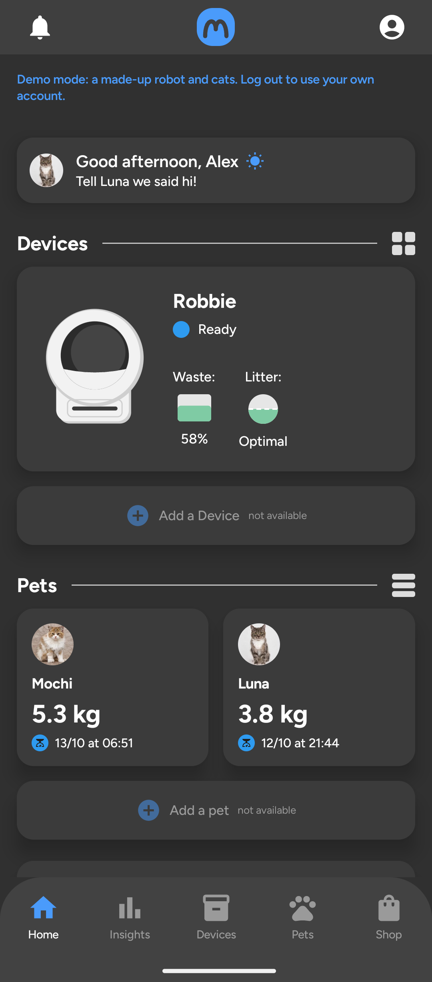
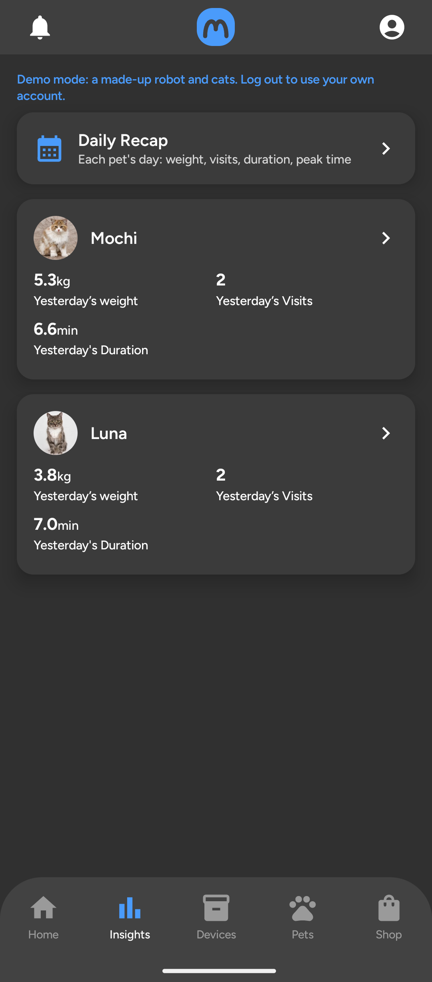
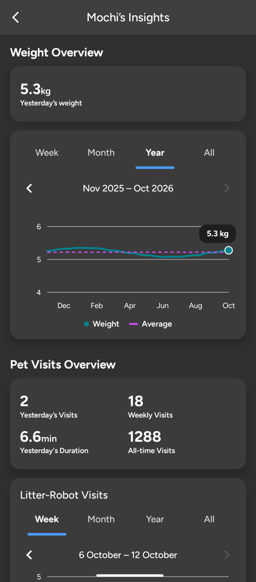
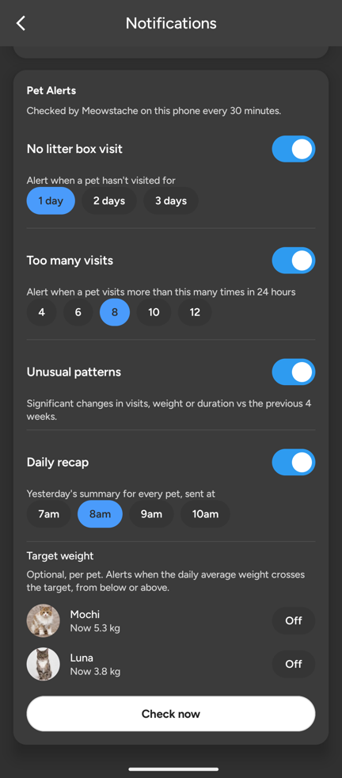

# Meowstache

[](https://github.com/gccammelli/meowstache/actions/workflows/build.yml)
[](https://codecov.io/gh/gccammelli/meowstache)
[](https://github.com/gccammelli/meowstache/releases/latest)
[](LICENSE)
[](https://github.com/gccammelli/meowstache/issues)

[](https://buymeacoffee.com/cammelli)

The Litter-Robot 4 is the best self-cleaning litter box around. But its maker now puts basic features behind a subscription, and owners haven't taken it well.

Subscriptions that pay for servers and new features are fine. But **history older than one week**, and alerts that can **save your cat's life** (no litter box visits, or too many), are basic features. They shouldn't be paywalled. My device. My data. This is how enshittification starts, and the Litter-Robot is heading down that path.

Meowstache is an unofficial Android app that talks to your robot and gives you:

- **Full history**: week, month, year and all-time charts for weight, visits and cycles. It's kept on your phone, so it outlives the server's retention.
- **Pet alerts**: no visit in N days, too many visits in 24 h, target weight crossed, unusual patterns, and a daily recap.
- Most of the official app's screens and controls, plus backup and restore of your history.
- A **demo mode** with fake data, so you can try it without an account.

<p>
  
  
  
  
</p>

No Litter-Robot? Tap **Try the demo** on the welcome screen to explore the app with a made-up robot, two cats and a year of fake history. No account needed. The screenshots above come from the demo.

## Download

[](https://github.com/gccammelli/meowstache/releases/latest/download/meowstache.apk)
[](https://github.com/gccammelli/meowstache/releases/latest/download/meowstache.ipa)

**[Download the latest APK](https://github.com/gccammelli/meowstache/releases/latest/download/meowstache.apk)** (or browse [all releases](https://github.com/gccammelli/meowstache/releases)). An F-Droid listing is on its way. Note that the F-Droid build is signed by F-Droid, so you can't update between the two: pick one.

### iOS

**[Download the latest .ipa](https://github.com/gccammelli/meowstache/releases/latest/download/meowstache.ipa)** and install it with [iloader](https://iloader.site/), [SideStore](https://sidestore.io), or [AltStore](https://altstore.io/), which signs it with your own Apple ID.

Meowstache displays native iOS notifications, but it has no push server, so it currently checks for new alerts only
while the app is open. In **cloud mode**, keep the official Whisker app installed for immediate background robot
notifications and use Meowstache alongside it for its additional history, insights and alerts. If you use **Home
Assistant or local mode**, its companion app can deliver instant notifications instead; see the
[iPhone notification guide](docs/iphone-notifications.md).

Making Meowstache deliver cloud-mode alerts while closed would require operating a trusted service that watches for
robot changes and sends them through Apple Push Notification service. iOS background refresh is not reliable enough
to replace that service, and requiring users' Whisker access tokens to leave their phones would be a significant
privacy and security trade-off.

## Local mode: no cloud at all (preview)

Robots running Joseph DiGiovanni's community [ESPHome firmware](https://codeberg.org/Joseph-DiGiovanni/esphome-litter-robot) don't talk to the manufacturer's cloud. Meowstache can read them through your own **Home Assistant** instead: pick **Local: Home Assistant** on the first screen, enter your Home Assistant address and a long-lived access token, and every screen (history, insights, alerts, controls) works from your own network. Use a dedicated non-administrator Home Assistant user for the app's token; it can do whatever that user can.

- Several robots are fine. Cats come from the firmware's cat tracker: enable the "Cat N" entities in Home Assistant and rename them to your cats' names (as the firmware's guide says). A cat with the same name on two robots becomes one pet.
- Give a cat a photo by setting a picture on its weight sensor in Home Assistant.
- More control than the cloud gives: a per-day sleep schedule, Empty Litter, the firmware's own filter reset, Smart Cat Detection / Auto Cycle / Odor Control, and adding, renaming or re-weighing cats on the robots' cat tracker (these need an administrator's token).
- Any model the firmware supports works (it supports the Litter-Robot 4 today).
- Not sure yet? **Try the demo** in local mode: two pretend robots behind a pretend Home Assistant.

It's tested against a real Home Assistant with simulated robots running the firmware's own cat tracker ([tools/local-mock](tools/local-mock)), not yet against a real flashed robot. Testers very welcome.

Android upstream compatibility checks and the autonomous update/release workflow:
[maintenance guide](docs/autonomous-android.md).

## Visit videos (optional)

Have a camera on the litter box? With a Home Assistant automation saving a clip of each visit, Meowstache adds a play button to the visit on the timeline. It works signed in with Whisker or in local mode, with any camera Home Assistant has (Ring included). Setup: [docs/visit-videos.md](docs/visit-videos.md).

## Before you use it

- It's an independent companion app. It **doesn't replace the official Litter-Robot app**, isn't affiliated with or endorsed by its maker, and some things (setup, adding devices or pets, some settings) still need the official app. Litter-Robot, SmartScale and LitterHopper are trademarks of Whisker (Automated Pet Care Products, LLC); other names are trademarks of their owners. Meowstache is not affiliated with or endorsed by Whisker.
- **Litter-Robot 4 only** with the cloud. Other robots aren't supported yet, so they won't show up (local mode supports what the ESPHome firmware supports).
- It has only been tested with one LR4. Help testing is very welcome: please open an issue.

## Support the project

Meowstache is free and always will be. Thanks to your support there's now an **iPhone beta** and a real iPhone to test it on. Donations keep development going and pay for the hardware it needs: test devices, an ESP programmer and parts for the open-firmware (local) work.

## Privacy & security

- You sign in with your normal Litter-Robot account, because the robot's data and controls only exist in the manufacturer's cloud.
- Cloud mode uses Whisker's unofficial, reverse-engineered cloud API, which may break at any time, and Whisker's terms of use do not permit third-party clients. Local mode (Home Assistant plus community firmware) avoids Whisker's servers entirely.
- Your password goes straight to the official login server over HTTPS and is **never stored**. The app only keeps a login token, encrypted with a key held in the phone's secure hardware (Android Keystore), and leaves it out of backups.
- The app only talks to the robot's official servers (or, in local mode, only to your Home Assistant). There are no analytics and no third parties. Details: [PRIVACY.md](PRIVACY.md).

## Contact

Questions, ideas or press: [meowstache.app@gmail.com](mailto:meowstache.app@gmail.com). Bugs: [GitHub issues](https://github.com/gccammelli/meowstache/issues).

## Contributing

Bug reports, feature requests and pull requests are welcome. See [CONTRIBUTING.md](CONTRIBUTING.md) for tests, privacy rules and the required before/after visual evidence for user-facing changes.

## Credits

Huge thanks to [pylitterbot](https://github.com/natekspencer/pylitterbot) by Nathan Spencer, the open-source library behind the [Home Assistant Litter-Robot integration](https://www.home-assistant.io/integrations/litterrobot/). Its years of work figuring out how the robot talks to its servers made this app possible. Meowstache is a separate implementation (no code was copied), built on that knowledge. Local mode exists thanks to Joseph DiGiovanni's [ESPHome Litter-Robot firmware](https://codeberg.org/Joseph-DiGiovanni/esphome-litter-robot).

## Licence

MIT (see `LICENSE`). The Figtree font is under the SIL Open Font License (`LICENSES/OFL-Figtree.txt`). The demo cats are AI-generated by [These Cats Do Not Exist](https://thesecatsdonotexist.com/).

## Disclaimer

This software is provided "as is", without warranty of any kind, express or implied, including but not limited to the warranties of merchantability, fitness for a particular purpose and noninfringement. Use it at your own risk. In no event shall the authors be liable for any claim, damages or other liability, including damage to your device, loss of data or harm to your pets, arising from the use of this software.

[](https://buymeacoffee.com/cammelli)

### Coverage checks

CI enforces at least **95% line coverage** for the shared Android debug code, using Kover. The only exclusion is the Compose-generated `io.github.gccammelli.meowstache.res` package: resource accessors and collectors produced under `shared/build/generated/compose/resourceGenerator/`. These are generated resource lookup tables and wrappers, rather than application decisions. Handwritten UI, demo behavior, networking, storage, encryption and device logic remain measured. Run the full automated suite and gate locally:

```sh
./gradlew testDebugUnitTest :shared:koverXmlReportDebug :shared:koverVerifyDebug
```

The report is `shared/build/reports/kover/reportDebug.xml`. Tests include simulated service boundaries and Robolectric screens; physical devices and iOS execution are separate checks.
