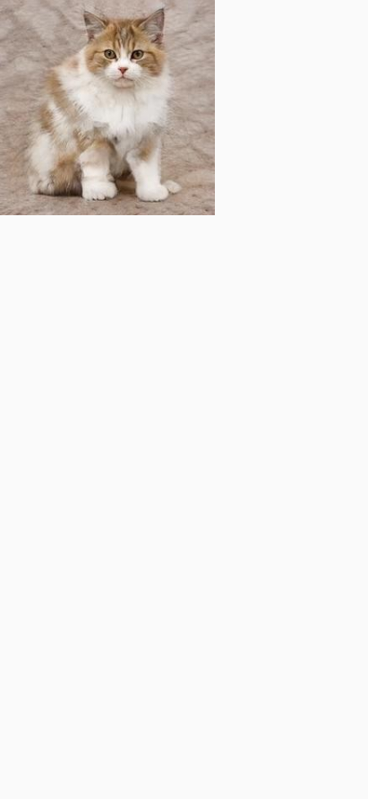
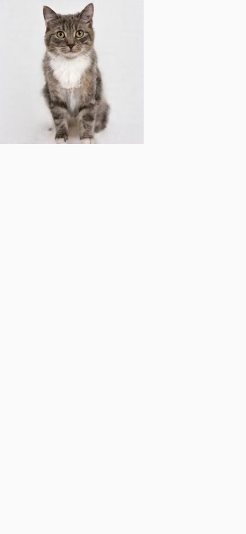
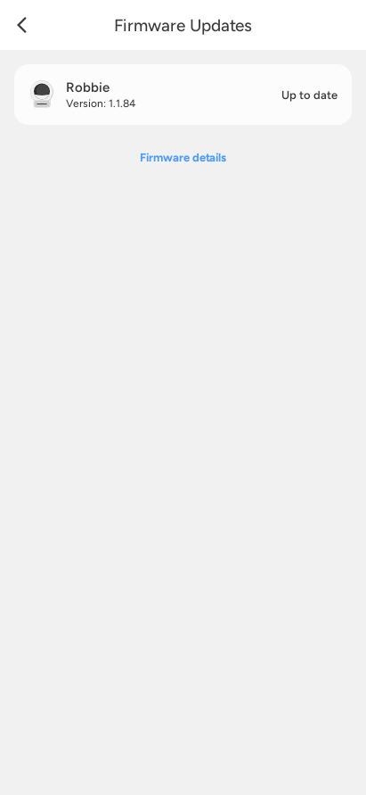
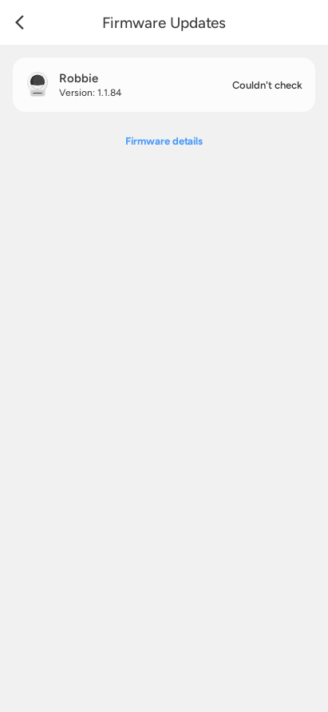

# Photo URL regression

These are actual Robolectric native Compose renders of the shared `NetImage` component. The test first loads Mochi, then changes the URL to Luna. The before image retains Mochi because the producer kept its old bitmap and skipped the new download; the after image correctly shows Luna.

| Before | After |
| --- | --- |
|  |  |

`UiKitTest.loadedAvatarsAreReusedAndThePhotoCacheStaysBounded` also checks cache reuse, eviction and the 24-image limit. Run the test with `MEOWSTACHE_AVATAR_EVIDENCE` set to an output PNG path to export the frame immediately after the first URL change. The before image was captured with only the producer's new value reset removed; that run failed the regression assertion. The fixed run passes.

These renders use bundled demo photos and a mocked HTTP transport. They do not claim a physical phone test.

# Incomplete firmware response

An empty or partial cloud firmware comparison used to be displayed as "Up to date". It now displays "Couldn't check" after the lookup completes. An explicit update-needed flag still shows an available update; "Up to date" requires all three comparison flags to be explicitly false.

| Before | After |
| --- | --- |
|  |  |

`ScreenTest.incompleteFirmwareDataShowsThatTheVersionCouldNotBeChecked` renders a mocked empty firmware response and asserts the status and absence of an install button. Set `MEOWSTACHE_FIRMWARE_EVIDENCE` to export the frame. The old implementation failed both this test and the repository regression; the new implementation passes. Repository tests also cover explicit false flags, an update for each firmware component, and a failed lookup.
